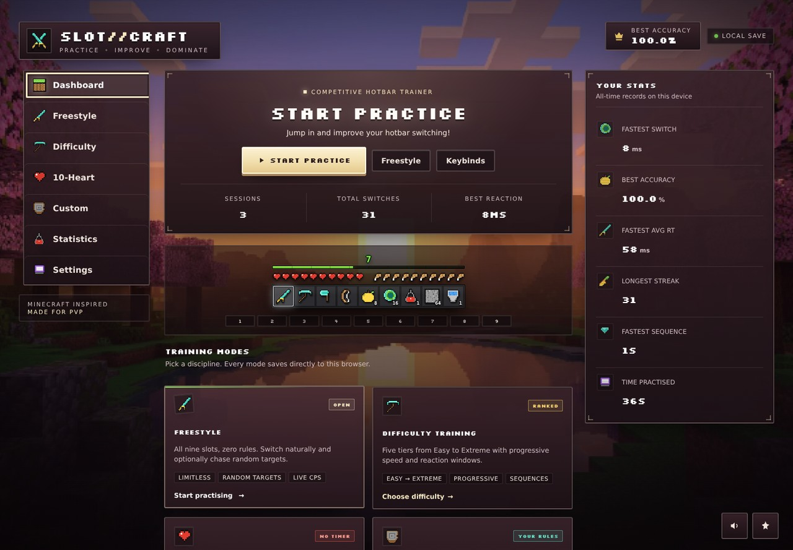
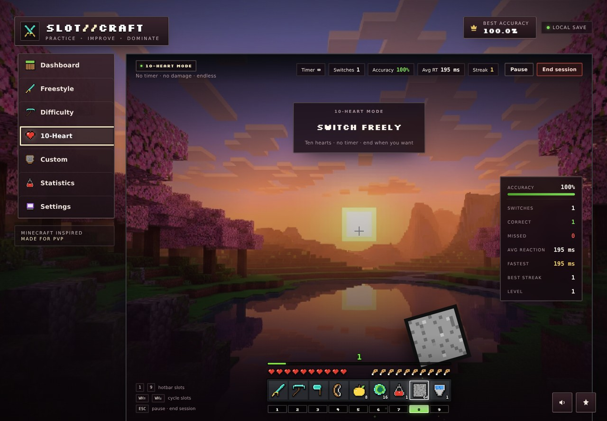
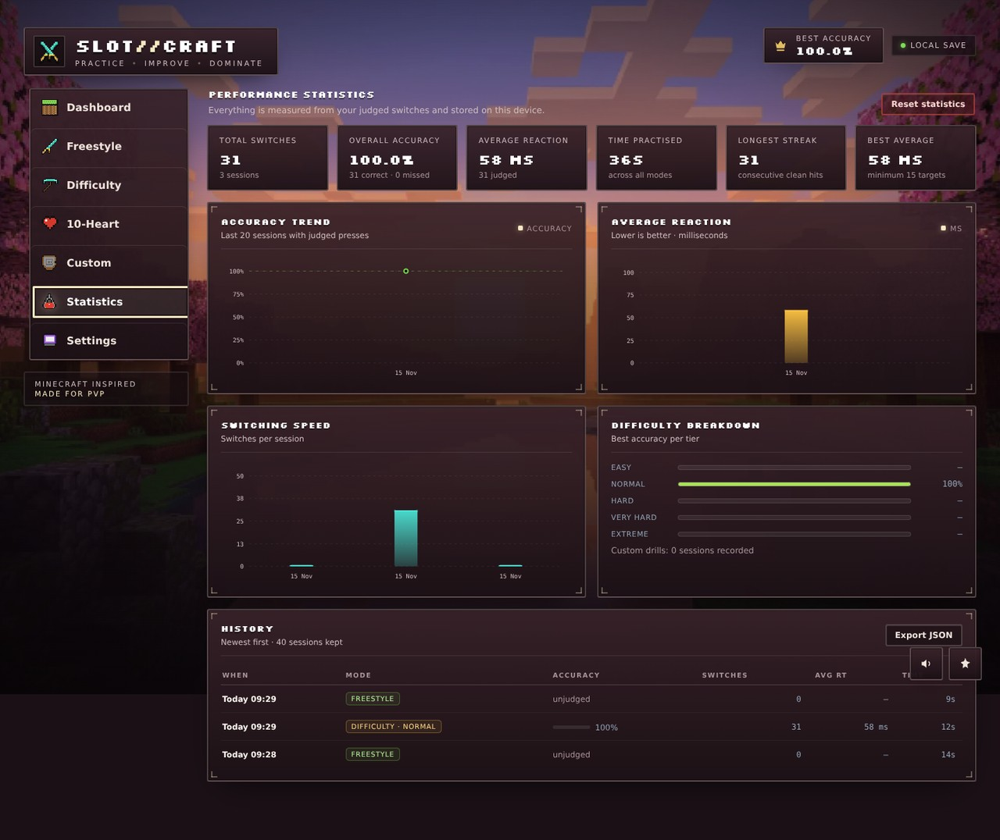
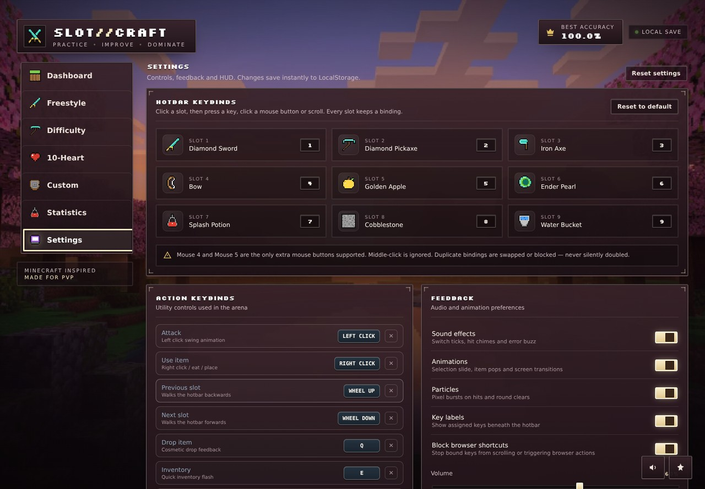
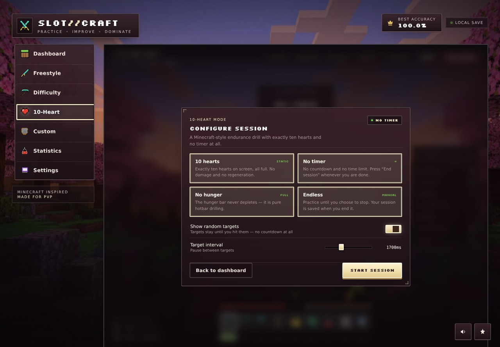
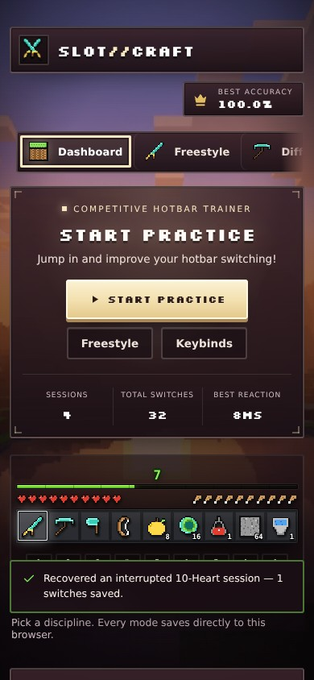

# SLOTCRAFT — Minecraft PvP Hotbar Trainer

A competitive, browser-based hotbar switching trainer built around a Minecraft-accurate HUD, wearing a
pixel-GUI skin: bevelled maroon panels, cream accents, a Silkscreen wordmark and a cherry-grove sunset
behind everything. No login, no backend, no build step — open it and drill.



## Run it

The app is plain HTML/CSS/ES modules, so it needs to be served over HTTP (module imports do not work from `file://`):

```bash
python3 -m http.server 4173
# then open http://localhost:4173
```

Or `npm start`, which runs the same server. Any static file server works (`npx serve .`,
`php -S localhost:4173`, nginx, GitHub Pages…). There is no build step and no runtime dependency.

## Screenshots

| Dashboard | Training arena |
| --- | --- |
|  |  |

| Statistics | Settings & keybinds |
| --- | --- |
|  |  |

| Session setup | Mobile |
| --- | --- |
|  |  |

## Modes

| Mode | What it does |
| --- | --- |
| **Freestyle** | All nine slots, no forced sequence, unlimited. Optional random targets with adjustable interval/lifetime. |
| **Difficulty Training** | Five tiers (Easy → Extreme) with progressively tighter reaction windows and longer sequences. Cleared rounds level you up; miss-heavy rounds step back down. |
| **10-Heart Mode** | Exactly ten hearts, no countdown, no hunger, no damage. Targets wait for you instead of timing out. End manually whenever. |
| **Custom Practice** | Choose sequence vs freestyle, active slots (min 2), reaction window, sequence length, gap, jump pattern and ramping. |
| **Statistics** | Accuracy trend, average reaction, switch volume, per-tier bests, full session history. |
| **Settings** | Keybinds, sound, animations, particles, HUD scale, theme, hotbar items, data import/export/reset. |

## Controls

* **1–9** switch hotbar slots (fully rebindable).
* **Mouse wheel up/down** cycle slots (rebindable actions).
* **Left / right click** attack / use (visual feedback, rebindable).
* **Mouse 4 & Mouse 5** are the only extra mouse buttons supported — middle click and buttons 6+ are rejected with a warning.
* **Q / E / R / F** are bound to optional utility actions by default and can be reassigned.
* **Esc** pauses the session (and cancels key capture).
* **Enter** starts the configured session while the setup panel is open.

Every hotbar slot is guaranteed a binding: assigning a key that another slot already owns swaps the two
bindings (with a warning) instead of creating a duplicate, and taking a key from an optional action
unbinds that action. Duplicate bindings are also detected on load and surfaced in the interface.

## What is measured

* total switches, correct/incorrect switches and accuracy (judged presses only)
* average, best and fastest reaction times
* best streak, rounds cleared, level reached
* fastest completed sequence, per-session duration and time practised

Session history keeps the last 40 runs. Everything is stored in `localStorage` under
`slotcraft.hotbar-trainer.v1`; nothing leaves the browser.

While a session is running a recovery snapshot is written every few seconds (and on page hide), so a
reload, a crash or a stray side-button navigation can never cost the run — the next load folds the
interrupted session into history and tells you how many switches were saved.

## Project structure

```
index.html            markup for dashboard, arena, statistics and settings
css/styles.css        design system: theme tokens, layout, panels, controls
css/hud.css           arena scene, hotbar, hearts/hunger/XP, cues, particles
js/app.js             controller: routing, sessions, settings, bindings UI
js/engine.js          training engine (modes, sequences, judging, progression)
js/hud.js             hotbar rendering, selection/XP/target animation
js/keybinds.js        input hub, binding labels, capture mode, shortcut blocking
js/pixelart.js        hand-authored 16×16 pixel-art sprite sheet (SVG)
js/store.js           LocalStorage persistence, stats aggregation, records
js/audio.js           synthesised WebAudio SFX (no audio files)
js/particles.js       canvas particle bursts
js/charts.js          dependency-free SVG charts
js/data.js            modes, difficulty tiers, defaults
js/utils.js           formatting helpers
```

## Tests

```bash
npm install   # jsdom, dev only
npm test
```

`test/app.test.mjs` drives the real app inside jsdom — routing, sessions, judging, keybinds, hotbar
filtering, persistence, recovery — and `test/modes.test.mjs` covers engine math: difficulty windows,
ramping, sequence growth, 10-heart rules and record tracking. Both suites fail on any console error or
uncaught exception. Current status: **55 + 48 assertions, all passing**.

## Design notes

* The interface is a single shell — backdrop, wordmark, vertical mode rail, content column — so every
  view shares the same chrome. Panels are translucent glass with an inner hairline, a 2px outer edge and
  cream corner brackets; the active rail item and primary button use the cream accent from the artwork.
* The hotbar, hearts, hunger and XP bar are rebuilt as SVG pixel art so they stay crisp at any HUD scale.
* The arena plays inside the same cherry-grove scene, dimmed by a vignette and a bottom scrim so the
  hotbar, hearts and target cue stay readable over a bright sunset.
* Type is two-tier: Silkscreen (SIL Open Font License, self-hosted in `assets/fonts/`) for the wordmark,
  headings, stat values and keycaps; the system sans for body copy and controls.
* Selection is a single animated frame element positioned from cached slot geometry — one transform per
  key press, no layout thrash, so input feels instant.
* All session scheduling runs in one `requestAnimationFrame` loop in an "elapsed session time" domain,
  which makes pausing exact and keeps the reaction window and timers in sync.
* Bound keys call `preventDefault`, while Ctrl/Cmd/Alt combinations are left alone so browser shortcuts
  keep working. In the arena the wheel and context menu are captured only for the arena surface, never
  while typing in an input, a modal or on a button.
* Chromium maps Mouse 4/5 to Back/Forward at the browser level, which no page can cancel — that is why
  the recovery snapshot exists. Everything else about the two side buttons behaves like any other bind.

## Assets

| File | Notes |
| --- | --- |
| `assets/backdrop.webp` | Cherry-grove sunset scene — AI-generated for this project, then downsampled to a 2px block grid. |
| `assets/fonts/silkscreen-*.woff2` | Silkscreen by Jason Kottke, SIL Open Font License (`assets/fonts/OFL.txt`). |

## Browser support

Built and tested in Chromium-based desktop browsers with a keyboard and mouse. Responsive layouts for
tablet and phone are included for reviewing stats and configuration, but the drills themselves are
keyboard-first by design.
